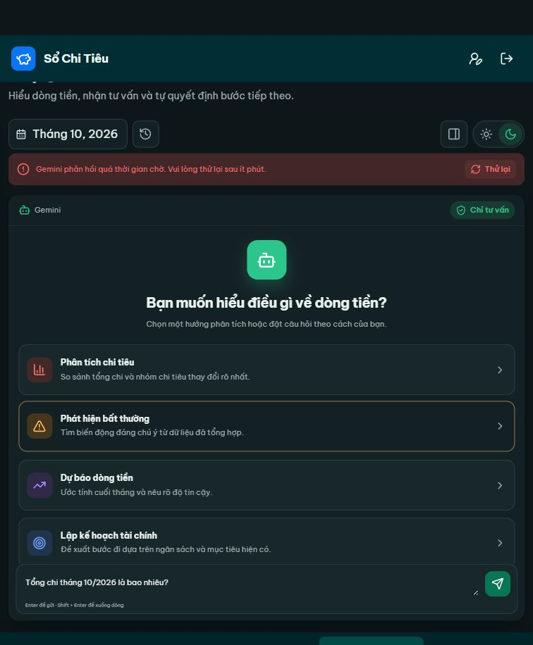

# TC-038 — Thông báo timeout của trợ lý AI

Mã hiện hành: **TC-038**; mã cũ: **TC-039**. Xem [đối chiếu mã](test-case-id-map.md).

**Kết quả: PASS theo phạm vi rút gọn do người dùng chấp nhận.** Quyết định: 28/10/2026. Bằng chứng UI: 27/10/2026, Asia/Saigon. Đây là cập nhật phạm vi và quyết định nghiệm thu; không phải lượt kiểm thử mới.

Phạm vi chỉ gồm hiển thị thông báo khi AI timeout và kết thúc trạng thái xử lý. Không yêu cầu mô phỏng các lỗi provider khác, phục hồi dịch vụ, thử lại thành công hay kiểm chứng lọc dữ liệu outbound.

| Mã test case | Tình huống kiểm thử | Dữ liệu kiểm thử | Kết quả mong muốn | Kết quả thực tế |
|---|---|---|---|---|
| TC-038 | Thông báo khi trợ lý AI timeout | Tháng=10; năm=2026; câu hỏi="Tổng chi tháng 10/2026 là bao nhiêu?"; tài khoản thử có bộ F. Sử dụng bằng chứng timeout UI ngày27/10/2026 | Thông báo rõ AI phản hồi quá thời gian chờ; kết thúc trạng thái đang xử lý | PASS |

Quan sát thực tế: “Gemini phản hồi quá thời gian chờ. Vui lòng thử lại sau ít phút.” UI hết trạng thái đang xử lý; ô nhập được mở lại và có nút Thử lại. Sự xuất hiện của nút không được dùng để kết luận đã thử lại thành công.

Bằng chứng xuất phát từ lúc hỏi TC-034 trước đây, nay được dùng để đối chiếu TC-038 đã rút gọn. Giữ nhãn nguồn gốc trong dữ liệu để truy vết. Không sửa kết quả lịch sử của các đợt cũ theo phạm vi rộng.

- [Trích xuất quan sát UI gốc, giữ mã cũ TC-039](evidence/tc039-timeout-2026-10-27-ui.json).
- [Kế hoạch hiện tại:38 ca](test-plan.md).

